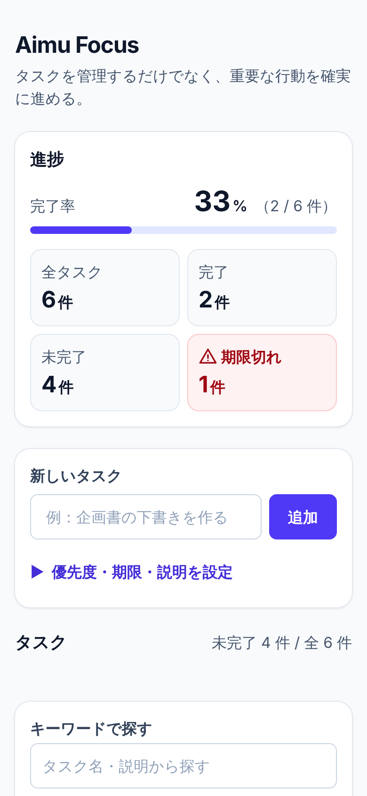
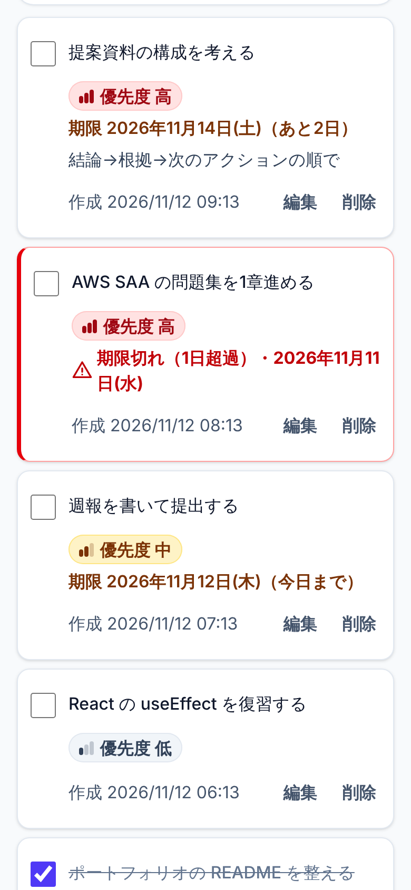
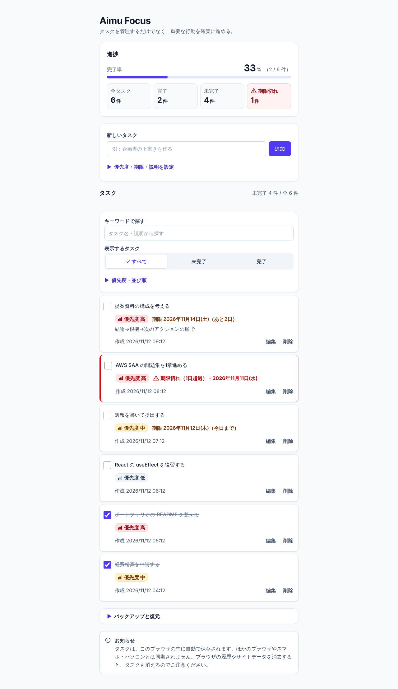

# Aimu Focus

**タスクを管理するだけでなく、重要な行動を確実に進める。**

仕事・副業・資格取得・プログラミング学習など、複数のタスクを抱える 20〜30 代の会社員のためのタスク管理 Web アプリです。
Next.js（App Router）と TypeScript で作成し、データはブラウザの localStorage に保存します。

**公開URL：** （Vercel へのデプロイ後に記載します）

<p>
  
  
</p>

---

## 解決したい課題

| 課題 | Aimu Focus での解決策 |
|---|---|
| タスクが多く、何から始めればよいか分からない | 優先度（高・中・低）と「期限が近い順」「優先度が高い順」の並び替え |
| 期限や優先順位の管理が難しい | 期限日の設定、期限切れ・今日まで・残り日数の自動表示 |
| タスクを登録しても進捗を把握できない | 完了率・期限切れ件数などを表示する進捗ダッシュボード |
| やるべきことが埋もれてしまう | キーワード検索と、状態・優先度による絞り込み |

## 主な機能

### 課題の必須要件

| 要件 | 実装内容 |
|---|---|
| タスクの追加・完了・削除 | Enter キーでも追加可能。削除は確認してから実行（Escape でキャンセル） |
| 空白のみのタスク登録を禁止 | 半角・全角スペースや改行だけの入力はエラー表示して登録しない |
| タスクがない場合の案内 | 「タスクはまだありません」と次にすることを表示 |
| localStorage による保存 | 操作のたびに自動保存。ブラウザを閉じても、再読み込みしても復元 |
| 保存データの破損への対応 | 壊れたデータでもアプリは停止せず注意を表示。元データは上書き前に別の場所へ残す |
| 書き込みエラーへの対応 | 容量超過などで保存できないときはエラーを表示 |
| スマートフォン対応 | 幅 320px から表示が崩れないことを確認。文字 16px 以上・ボタン 44px 以上 |

### 追加機能

- **タスクの詳細管理**：タスク名の編集、説明、優先度、期限日、作成日時・更新日時
- **検索・絞り込み・並び替え**：キーワード検索（全角半角・大文字小文字を区別しない／スペース区切りで複数語）、すべて・未完了・完了、優先度、4 種類の並び順
- **進捗ダッシュボード**：全タスク・完了・未完了・完了率・期限切れの件数
- **バックアップと復元**：JSON ファイルへの保存と読み込み。読み込む前に中身をすべて検証し、置き換え前の確認・事前保存・復元の取り消しで誤操作によるデータ消失を防ぐ

<p>
  
</p>

<details>
<summary>PC での表示</summary>



</details>

## 使用技術

| 分類 | 技術 |
|---|---|
| フレームワーク | Next.js 16.4（App Router）、React 19.3 |
| 言語 | TypeScript 5.9 |
| スタイル | Tailwind CSS 4.3 |
| データ保存 | localStorage（ブラウザ標準の保存領域） |
| テスト | Vitest 5.1、React Testing Library 16.3、jsdom |
| 品質チェック | ESLint 9（eslint-config-next） |
| 公開 | GitHub、Vercel |

データベースや外部の認証サービスは使っていません。状態管理は React 標準の機能（useState・useSyncExternalStore・カスタムフック）だけで行っています。

## ローカルでの起動方法

Node.js 20.9 以上が必要です（22 系で動作確認しています）。

```bash
git clone https://github.com/kunotakato/aimu-focus.git
cd aimu-focus
npm install
npm run dev
```

ブラウザで http://localhost:3000 を開きます。

## テスト方法

```bash
npm test            # 自動テスト（127 件）
npm run lint        # ESLint
npm run typecheck   # TypeScript の型チェック
npm run build       # 本番ビルド
```

課題で求められたテスト項目と、実際のテストの対応表は [docs/TESTING.md](docs/TESTING.md) にまとめています。

## 技術的な工夫

### 1. Hydration Error を起こさない設計
Next.js はまずサーバーで HTML を作りますが、サーバーには localStorage がありません。
そこで `useSyncExternalStore` を使って「サーバーと、ブラウザでの最初の描画」ではどちらも「読み込み中」を表示し、ブラウザで動き始めてから保存データを読むようにしました。
サーバーとブラウザの最初の画面が必ず一致するため、Hydration Error が起きません（[`src/hooks/useIsClient.ts`](src/hooks/useIsClient.ts)）。

### 2. 「保存データは壊れているかもしれない」前提の読み込み
localStorage やバックアップファイルの中身は、TypeScript の型では保証されません。
[`src/lib/validation.ts`](src/lib/validation.ts) で 1 項目ずつ検証してから使います。

- 一部だけ壊れていれば、読めたタスクだけ表示して件数を伝える
- 上書きする前に、元のデータを別の場所へ残す（残せなければ保存を中止する）
- 保存データに形式番号（version）を入れ、将来データの形を変えても見分けられるようにする

### 3. ロジックと画面の分離
タスクの追加・編集・絞り込み・集計などは、画面に触らない「純粋関数」として [`src/lib/`](src/lib) にまとめました。
同じ入力なら必ず同じ結果になるため、テストが書きやすく、画面のテストと合わせて 127 件のテストで動作を確認しています。

### 4. 誤解させない表示
- タスクが 0 件のとき、完了率を「0%」と出さない（「何もできていない」と誤解させないため）
- 完了率は切り捨てで計算する（200 件中 199 件で「100%」と表示しないため）
- 期限切れや優先度は、色だけでなくアイコン・棒の本数・言葉でも区別する

### 5. 使いやすさ・アクセシビリティ
- 日本語入力で変換を確定する Enter ではタスクを登録しない
- 削除・編集のあと、キーボードの操作位置（フォーカス）を次のタスクや元のボタンに移す
- 操作結果（「〇〇を追加しました」など）を表示し、読み上げソフトにも伝える
- axe-core によるアクセシビリティ検査で違反 0 件

## 制約事項

- **データはこのブラウザの中にだけ保存されます。** ほかのブラウザ・端末とは同期されません。
- ブラウザの履歴やサイトデータを消去すると、タスクも消えます。必要に応じて「バックアップと復元」でファイルに保存してください。
- プライベートモードや、ブラウザの設定によっては保存できない場合があります（その場合は画面に表示します）。
- 「復元の取り消し」は、ページを開いている間だけ使えます。
- 実機のスマートフォン（特に iPhone の Safari）での動作と、日本語入力の Enter キーの動作は未確認です。

## 今後の改善案

- データベースとログイン機能を追加し、複数の端末で同期する
- バックアップの「追加で読み込む（統合）」モード
- 今日やるタスクを選ぶ「フォーカスモード」（コンセプトの「重要な行動を確実に進める」を強化）
- 繰り返しタスク（毎週の週報など）
- ダークモード
- Playwright による E2E テストの自動化と、GitHub Actions での CI

## ディレクトリ構成

```
src/
├── app/          # ページ（Server Component）
├── components/   # 画面の部品（Client Component）とその画面テスト
├── hooks/        # カスタムフック（タスクの状態管理、今日の日付など）
├── lib/          # 画面に依存しない処理（タスク操作・保存・検証・検索・集計・バックアップ）とそのテスト
└── types/        # 型定義（Task など）
docs/
├── TESTING.md    # 必須テスト項目との対応表
└── images/       # README 用のスクリーンショット
```
