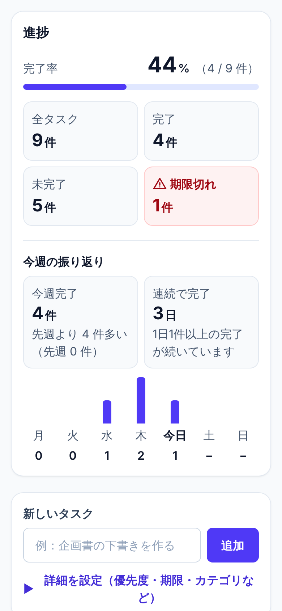
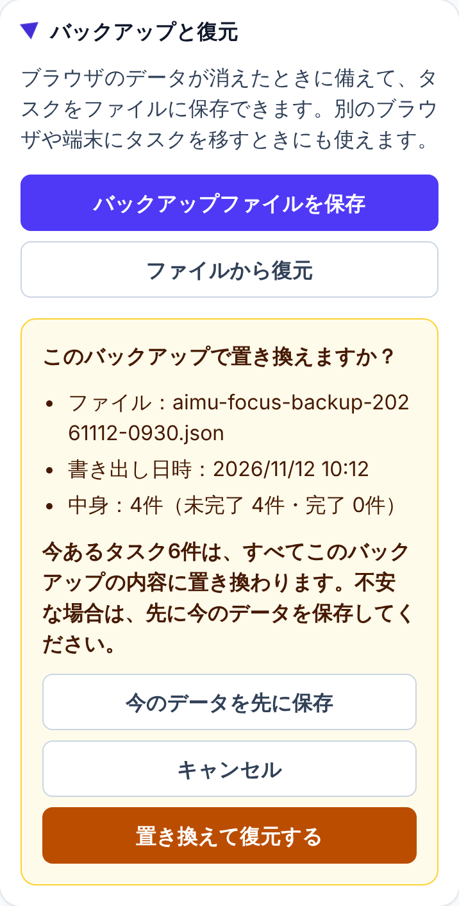

# Aimu Focus

**タスクを管理するだけでなく、重要な行動を確実に進める。**

仕事・副業・資格取得・プログラミング学習など、複数のタスクを抱える 20〜30 代の会社員のためのタスク管理 Web アプリです。
Next.js（App Router）と TypeScript で作成し、データはブラウザの localStorage に保存します。

**公開URL：** https://aimu-focus.vercel.app

<p>
  
  
  
</p>

---

## 解決したい課題

| 課題 | Aimu Focus での解決策 |
|---|---|
| タスクが多く、何から始めればよいか分からない | 優先度（高・中・低）と「期限が近い順」「優先度が高い順」の並び替え |
| 期限や優先順位の管理が難しい | 期限日の設定、期限切れ・今日まで・残り日数の自動表示 |
| 今日本当にやるべきことが埋もれる | 「今日やる」を3件までに絞る「今日のフォーカス」 |
| 同じ作業を毎回登録し直すのが面倒で、習慣が続かない | 完了すると次回分を自動で作る繰り返しタスク、週の振り返りと連続日数 |
| タスクを登録しても進捗を把握できない | 完了率・期限切れ件数などを表示する進捗ダッシュボード |
| やるべきことが埋もれてしまう | キーワード検索と、状態・優先度による絞り込み |

## 主な機能

### 課題の必須要件

| 要件 | 実装内容 |
|---|---|
| タスクの追加・完了・削除 | Enter キーでも追加可能。削除は確認してから実行（Escape でキャンセル） |
| 空白のみのタスク登録を禁止 | 半角・全角スペースや改行だけの入力はエラー表示して登録しない |
| タスクがない場合の案内 | 「タスクはまだありません」と次にすることを表示 |
| localStorage による保存 | 操作のたびに自動保存。ブラウザを閉じても、再読み込みしても復元 |
| 保存データの破損への対応 | 壊れたデータでもアプリは停止せず注意を表示。元データは上書き前に別の場所へ残す |
| 書き込みエラーへの対応 | 容量超過などで保存できないときはエラーを表示 |
| スマートフォン対応 | 幅 320px から表示が崩れないことを確認。文字 16px 以上・ボタン 44px 以上 |

### 課題2で提出する追加機能（3つ）

自分で考えた3つの追加機能です。「誰の・どんな課題を・どう解決するか」は [docs/FEATURE-IDEAS.md](docs/FEATURE-IDEAS.md) にもまとめています。

| 機能 | 誰の | どんな課題を | どう解決するか |
|---|---|---|---|
| **G. 削除の取り消し** | ボタンの押し間違えが多発している人 | 消すつもりではない項目を消してしまう | 消してしまっても8秒以内なら「元に戻す」で取り戻せるようにする（ヒューマンエラーを防ぐ） |
| **H. 日報コピー** | 毎日、同じ報告を作成している人 | 毎日同じ形を一から作成している | 同じ形に固定し、今日完了したタスクと明日やるタスクを自動で書き込んで、ボタン1つでコピーできるようにする |
| **L. テンプレート** | 似たタスクを何度も登録する会社員 | 毎回一から入力しないといけない面倒さ | よく使うタスクを保存しておき、ボタンひとつで追加できるようにして、考えることの負担を減らす |

**どう動くか**
- **G. 削除の取り消し**：削除後8秒間、画面下に「『〇〇』を削除しました［元に戻す］」を表示し、元の位置・元の内容で戻せる。通知にマウスを乗せている間は時間が止まる。Ctrl/⌘ + Z でも戻せる。削除前の確認（課題1）も残している
- **H. 日報コピー**：「今日完了したこと」と「明日やること」（期限が明日までのもの・期限切れ・今日やるで残ったもの）を日報の文章にまとめ、ボタン1つでクリップボードにコピー。Slack やメールにそのまま貼れる
- **L. テンプレート**：新規追加の「詳細を設定」で「テンプレートにも保存する」にチェックすると、名前・説明・優先度・カテゴリ・繰り返しを保存（最大10個、期限日は保存しない）。入力欄の下のボタンからワンタップで追加でき、バックアップにも含まれる

### おまけの機能

| 機能 | 内容 |
|---|---|
| **F. 週の振り返り** | 完了日時を記録し、今週と先週の完了件数・曜日ごとの完了数・**連続で完了した日数**を表示。続けられていることに気づけるようにする（「AI 伴走」への発展は[今後の改善案](#今後の改善案)を参照） |

### そのほかに追加した機能

| 機能 | 内容 |
|---|---|
| **A. 今日のフォーカス** | 「☆ 今日やる」で、今日いちばん大事なタスクを**最大3件**選び、画面のいちばん上に表示。日付が変わると自動で外れる |
| **B. カテゴリ分け** | 仕事・副業・学習・生活・その他のカテゴリを付け、カテゴリで絞り込める |
| **C. 繰り返しタスク** | 毎日・毎週・毎月を設定すると、完了したときに**次回分を期限付きで自動作成**（チェックを付け直しても重複しない） |

### 追加機能（課題1）

- **タスクの詳細管理**：タスク名の編集、説明、優先度、期限日、作成日時・更新日時
- **検索・絞り込み・並び替え**：キーワード検索（全角半角・大文字小文字を区別しない／スペース区切りで複数語）、すべて・未完了・完了、優先度、4 種類の並び順
- **進捗ダッシュボード**：全タスク・完了・未完了・完了率・期限切れの件数
- **バックアップと復元**：JSON ファイルへの保存と読み込み。読み込む前に中身をすべて検証し、置き換え前の確認・事前保存・復元の取り消しで誤操作によるデータ消失を防ぐ

<p>
  
</p>

<details>
<summary>PC での表示</summary>


</details>

## 使用技術

| 分類 | 技術 |
|---|---|
| フレームワーク | Next.js 16.4（App Router）、React 19.3 |
| 言語 | TypeScript 5.9 |
| スタイル | Tailwind CSS 4.3 |
| データ保存 | localStorage（ブラウザ標準の保存領域） |
| テスト | Vitest 5.1、React Testing Library 16.3、jsdom |
| 品質チェック | ESLint 9（eslint-config-next） |
| 公開 | GitHub、Vercel |

データベースや外部の認証サービスは使っていません。状態管理は React 標準の機能（useState・useSyncExternalStore・カスタムフック）だけで行っています。

## ローカルでの起動方法

Node.js 20.9 以上が必要です（22 系で動作確認しています）。

```bash
git clone https://github.com/kunotakato/aimu-focus.git
cd aimu-focus
npm install
npm run dev
```

ブラウザで http://localhost:3000 を開きます。

## テスト方法

```bash
npm test            # 自動テスト（219 件）
npm run lint        # ESLint
npm run typecheck   # TypeScript の型チェック
npm run build       # 本番ビルド
```

課題で求められたテスト項目と、実際のテストの対応表は [docs/TESTING.md](docs/TESTING.md) にまとめています。

## 技術的な工夫

### 1. Hydration Error を起こさない設計
Next.js はまずサーバーで HTML を作りますが、サーバーには localStorage がありません。
そこで `useSyncExternalStore` を使って「サーバーと、ブラウザでの最初の描画」ではどちらも「読み込み中」を表示し、ブラウザで動き始めてから保存データを読むようにしました。
サーバーとブラウザの最初の画面が必ず一致するため、Hydration Error が起きません（[`src/hooks/useIsClient.ts`](src/hooks/useIsClient.ts)）。

### 2. 「保存データは壊れているかもしれない」前提の読み込み
localStorage やバックアップファイルの中身は、TypeScript の型では保証されません。
[`src/lib/validation.ts`](src/lib/validation.ts) で 1 項目ずつ検証してから使います。

- 一部だけ壊れていれば、読めたタスクだけ表示して件数を伝える
- 上書きする前に、元のデータを別の場所へ残す（残せなければ保存を中止する）
- 保存データに形式番号（version）を入れ、将来データの形を変えても見分けられるようにする

### 3. ロジックと画面の分離
タスクの追加・編集・絞り込み・集計などは、画面に触らない「純粋関数」として [`src/lib/`](src/lib) にまとめました。
同じ入力なら必ず同じ結果になるため、テストが書きやすく、画面のテストと合わせて 219 件のテストで動作を確認しています。

### 4. 課題1のデータを引き継ぐマイグレーション
課題2でタスクの項目（カテゴリ・繰り返し・今日やる・完了日時）が増えたため、保存データの形式番号を 1 → 2 に上げました。
形式1で保存されたデータやバックアップファイルは、読み込むときに自動で形式2へ変換するので、課題1で登録したタスクはそのまま使えます（[`src/lib/validation.ts`](src/lib/validation.ts) の `migrateTaskFromV1`）。

### 5. 誤解させない表示
- タスクが 0 件のとき、完了率を「0%」と出さない（「何もできていない」と誤解させないため）
- 完了率は切り捨てで計算する（200 件中 199 件で「100%」と表示しないため）
- 期限切れや優先度は、色だけでなくアイコン・棒の本数・言葉でも区別する

### 6. 使いやすさ・アクセシビリティ
- 日本語入力で変換を確定する Enter ではタスクを登録しない
- 削除・編集のあと、キーボードの操作位置（フォーカス）を次のタスクや元のボタンに移す
- 操作結果（「〇〇を追加しました」など）を表示し、読み上げソフトにも伝える
- axe-core によるアクセシビリティ検査で違反 0 件

## 制約事項

- **データはこのブラウザの中にだけ保存されます。** ほかのブラウザ・端末とは同期されません。
- ブラウザの履歴やサイトデータを消去すると、タスクも消えます。必要に応じて「バックアップと復元」でファイルに保存してください。
- プライベートモードや、ブラウザの設定によっては保存できない場合があります（その場合は画面に表示します）。
- 「復元の取り消し」は、ページを開いている間だけ使えます。
- 繰り返しタスクの次回分は、完了したときに作られます。完了を取り消しても、作られた次回分は残ります（必要なければ削除してください）。
- 毎月の繰り返しで、翌月にその日がない場合（1月31日など）は月末日になり、以降はその日付で続きます。
- 課題1で完了済みにしたタスクは完了日時の記録がないため、最終更新日時を完了日とみなして振り返りに数えます。
- 実機のスマートフォン（特に iPhone の Safari）での動作と、日本語入力の Enter キーの動作は未確認です。
- 「削除の取り消し」は、削除してから8秒間（通知にマウスを乗せている間は延長）だけ使えます。別の操作をすると使えなくなります。
- 日報のコピーは、ブラウザの設定によって使えない場合があります。そのときは下書きの文章を選択してコピーしてください。
- テンプレートは期限日を保存しません（使う日によって変わるため）。課題1・課題2で書き出したバックアップにはテンプレートが入っていないので、復元しても今のテンプレートはそのまま残ります。

## 今後の改善案

- **週の振り返りを「AI 伴走」に発展させる**（F の発展）：自己成長を狙う人が、完了の記録をもとに「何がダメだったか（改善が必要なこと）」「何を継続するべきか」を AI と一緒に振り返れるようにする。今の F は件数と連続日数を見せるところまでで、ふり返りの中身（なぜできたか・できなかったか）までは扱えていないため
- データベースとログイン機能を追加し、複数の端末で同期する
- バックアップの「追加で読み込む（統合）」モード
- 振り返りに「カテゴリ別の完了数」や、ひとことメモを書ける機能
- 繰り返しの曜日指定（平日のみ、毎週月・木 など）
- ダークモード
- Playwright による E2E テストの自動化と、GitHub Actions での CI

## ディレクトリ構成

```
src/
├── app/          # ページ（Server Component）
├── components/   # 画面の部品（Client Component）とその画面テスト
├── hooks/        # カスタムフック（タスクの状態管理、今日の日付など）
├── lib/          # 画面に依存しない処理（タスク操作・保存・検証・検索・集計・バックアップ）とそのテスト
└── types/        # 型定義（Task など）
docs/
├── FEATURE-IDEAS.md  # 追加機能のアイディア（誰の・どんな課題を・どう解決するか）
├── TESTING.md    # 必須テスト項目との対応表
└── images/       # README 用のスクリーンショット
```
